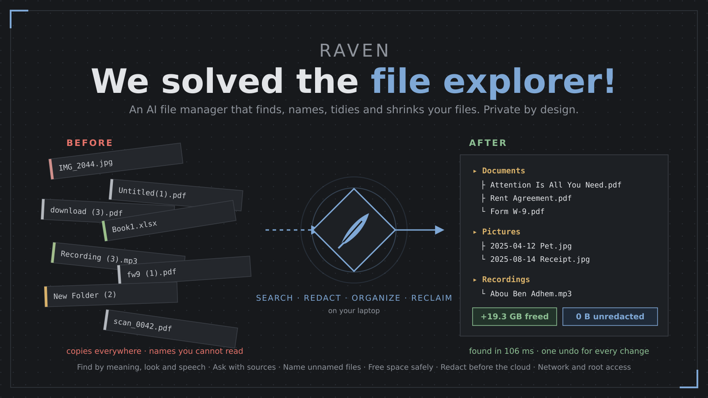
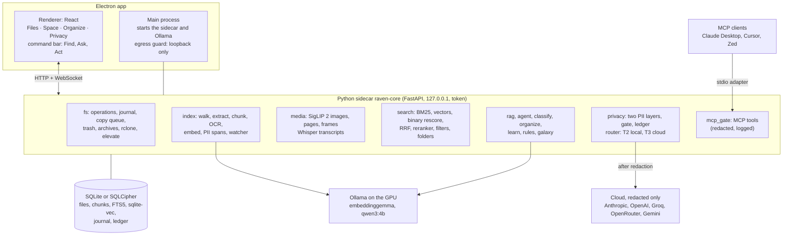

# Raven

**A desktop file manager that finds, organizes and shrinks your files with AI. Your private data never leaves your laptop unredacted.**

     



Raven is a desktop file manager (Electron and React) with a local Python sidecar. It indexes the folders that you
choose, and then it can find a file by its name, its words, its meaning or its appearance. It answers questions with
citations, runs file commands that you review first, and shows where your disk space goes. Each change has one undo.

## Download (beta)

The beta builds for Linux (AppImage) and Windows (installer) are in
[9u3u3/ravenfiles](https://github.com/9u3u3/ravenfiles/releases/latest). Report problems in
[its issues](https://github.com/9u3u3/ravenfiles/issues). Its `BETA-LICENSE.md` says how you can use the beta.

## Quick start (development)

You need these tools:

- [uv](https://docs.astral.sh/uv/) (it installs Python 3.12 for the sidecar)
- Node 22 and [pnpm](https://pnpm.io/)
- [Ollama](https://ollama.com/download)

```bash
git clone https://github.com/9u3u3/Raven.git
cd Raven
cd core && uv sync && cd ..
cd app && pnpm install && pnpm dev
```

The app starts the sidecar and `ollama serve`. The first-run screen downloads the missing models (about 4.9 GB).
See [Run it (development)](#run-it-development) for the optional tools and the test data.

## What Raven does

**Find** (`Ctrl+K`, then `Ctrl+Enter` for all results)
- Hybrid search: fuzzy names, BM25 on the text, meaning vectors, fused with RRF, then a cross-encoder reranker.
- Search by appearance: SigLIP 2 finds photos, PDF pages and video moments from a description ("a bar chart",
  "the sunset"). A video result opens at the matched second, with a strip of keyframes under the preview.
- "Find similar" in the context menu finds images, pages and videos that look alike.
- Speech: Whisper writes timed transcripts of audio and video, so Find and Ask also read what people say.
- Filters: `type:pdf`, `>2MB`, `after:2026-01`, `in:Downloads`, and phrases such as "older than 6 months", "two weeks
  ago" or "last semester". The local model reads the filter words that the rules do not know. The chips show what it
  read, and you can remove each chip.
- Folder search: a folder by its name, its path or a description of what it holds. Frequent folders come first.

- Kind: the Kind column reads the first bytes of a file when its name says nothing or the wrong thing. A PDF
  named `notes.txt` gets a mark, and a program with a document name gets a warning.
- Filters for power users: `owner:harsh`, `perm:755`, `perm:x`, `is:link`, `is:broken`, `is:hidden`, `is:system`, `tag:work`.

**Ask** (a question in the command bar)
- An answer from your files with numbered citations. A citation opens the file at its page or at the spoken moment.
- "I did not find this in your files" when no file is close enough. Raven does not guess.
- The local model answers short questions. Think harder may use the cloud, after redaction.

**Act** (a file command in the command bar)
- "convert all DOCX files in Sem5 to PDF and move them to Submissions": a grammar, the local model or the cloud plans
  it. Every plan opens in the review view first. One undo reverses the whole command.

**Space**
- A treemap and a sunburst, bars by category and last use, a growth line from daily size snapshots, and a free space
  bar with an "after the plan" marker.
- Exact duplicates (size, quick hash, BLAKE3) and similar photos (perceptual hash, 6 bits or fewer apart). For similar
  photos, Raven keeps the highest resolution and checks no photo for you. You choose each one.
- Safe junk rules and suggestions.
- Reclaim: one total of the space Raven can free, one row per source (app, browser and developer caches,
  trash, large old files, archives already extracted, the same document twice, duplicate folders, lossless
  optimizers, hard links, similar videos, Docker, system logs and package caches). "Free 20 GB" picks the
  safest rows first. A forecast says when the disk is full. Large old files can move to another drive.
- Smart compression (7z, tar.zst, zip, zstd, lossless JPEG XL) with BLAKE3 checks, records, restore and ghost space.
  Auto mode runs your rules when the laptop is idle and on power.

**Organize**
- Plan a folder: categories from a cascade (rules, embeddings, the local model), before and after trees, Apply, Undo.
- Watch rules: move or rename new files in a folder by category, extension or name. Each run is one undo.
- Learning: "Set category" makes a file an example for files like it. A folder that you choose in a plan is kept for
  that category. After three similar manual moves, Raven suggests a rule.
- File map (File Galaxy): every indexed file as a point, placed by meaning. Groups get names from the local model. A
  group can become one folder.

- Name unnamed files: `IMG_2044.jpg`, `WhatsApp Image …`, `Screenshot_…`, `Book1.xlsx`, `Recording (3).m4a`
  get a real name from the title, the text in the image (OCR), what the photo shows (SigLIP 2) or what is said
  (Whisper). One review, one undo. A watch rule can name new files.
- Graph: files as dots and links as lines, as in Obsidian: Markdown links and wikilinks, imports, mentions of a
  file name, similar meaning and the same content. Shift-drag selects files and moves them into a folder.
  The file map by meaning is the second layout. The Inspector shows the links of one file..

**Privacy**
- AI modes: Local only, Hybrid. Offline, the mode line says `LOCAL ONLY (offline)`.
- Review before send: every cloud payload waits for you. You see what Raven hid, the words that may still be
  private, and the exact text. A local decision model (the strict privacy model) and patterns rank each
  suspicious word with a category (name, company, project, address, money, ID number, health, password) and a
  score. You hide what you want, then send or not. Send sends that exact text.
- Two PII layers (patterns with checksums, and the OpenAI Privacy Filter), a redaction gate, and a ledger of every
  byte that leaves the laptop. The patterns cover India's IDs (Aadhaar, VID, PAN, GSTIN, passport, voter ID, driving
  licence, UAN, ABHA, ration card) and the types that apply everywhere (cards with CVV and expiry, IBAN, crypto
  wallets, health records, secrets, OTPs). A column header in a table also marks the values below it.
- Strict privacy: a second model (GLiNER PII, 197 MB) finds the names, addresses and health words that the Privacy
  Filter misses. On a hand-written test set, names go from 50 % to 92 % and addresses from 40 % to 100 %. A name
  that a model finds once is hidden in every place of the request, and so is each part of a full name.
- Fail closed: without the Privacy Filter (or the strict model, when Strict privacy is on), nothing goes to the cloud. Photos, videos and audio never go to the cloud.
- Words to always hide: family names, a company, a client. Private folders: no AI and no model reads them.
- Cloud providers: Anthropic, OpenAI, Groq, OpenRouter, Google Gemini, or any OpenAI-compatible server. Groq,
  Gemini and OpenRouter have free plans. Raven tries them in your order.
- Encrypted index (SQLCipher) with a passphrase, or with the system keyring.
- Raven as an MCP server: Claude Desktop, Cursor or Zed can search, read and ask your files through the same gate.
  The tools only read. MCP is off until you turn it on. Settings, MCP clients adds Raven to Claude Desktop, Cursor,
  Windsurf, VS Code or Claude Code with one button.

- Habits (local only, one switch, one delete): files you open often rank higher, Continue shows the files you
  probably want now, the Inspector says where a file usually goes, new names follow your naming style, and a
  suggestion you reject stays away for 30 days.

**Files**
- List and grid views, the inspector with previews, tabs (`Ctrl+T`), dual pane (`F3`), drag and drop, and undo and redo
  for every operation.
- A copy queue with progress, pause and cancel, and a conflict dialog (replace, skip, keep both).
- Batch rename (`F2` with many items): find and replace, regular expressions, templates, case, with a live preview.
- Archives open like folders (zip, tar, tar.zst, 7z and more). Create archive and Extract here.
- Copy path, and Copy relative path (from the project root, else `~/...`).
- Restore from the trash, checksums (SHA-256, BLAKE3), conversion between file types, OCR for scans.
- Network: SMB, SFTP, NFS, FTP and WebDAV through `gio`, and WebDAV, S3, SFTP, Google Drive, Dropbox and OneDrive
  through `rclone`.
- Power user mode: after "Permission denied", "Retry as administrator" (`pkexec` on Linux, UAC on Windows).
- Granular control: permissions (a grid and an octal field, also recursive), owner, dates, tags, the immutable
  flag, symbolic and hard links, "Who uses it?", a one-line explanation of system folders, full view (the root
  folder and hidden files), folder rules (not indexed, never to the cloud, never changed, never compressed),
  mount, unmount and eject, and shred. Every change has one undo.
- Network: every feature works on SMB, SFTP, FTP, WebDAV and S3 shares (`docs/network-matrix.md`). A share
  that does not answer gives an error in 5 s, and Raven sees changes from other computers within a minute.

**Lite mode** (for computers with little RAM, no GPU or few cores)
- No Ollama: a static embedding model on the CPU, no reranker, image or speech models unless you turn them on,
  a low priority, and a pause on battery. Ask shows the best passages with citations. Each AI feature has its
  own switch. Raven suggests the mode from the hardware at first start.

## Numbers (this laptop, test data)

Measured on 2026-10-15 with `core/scripts/latency.py`, `scripts/pii_recall.py` and `scripts/bench_binary.py`.
The GPU (RTX 3050 6 GB laptop) stays in power state P5 (memory clock 810 MHz), so the local LLM is slower than the
plan expects.

| Step | Median | Budget |
|---|---|---|
| Name and keyword search | 6 ms | 100 ms |
| Full hybrid search with the reranker | 106 ms | 500 ms |
| Folder search | 65 ms | 300 ms |
| Search by appearance (SigLIP 2, CPU) | 25 ms | 300 ms |
| Redaction of new text (both layers, CPU, model loaded) | 53 ms | 50 ms (the budget is for cached spans) |
| Redaction with Strict privacy (3 models, 40 words, loaded) | 96 ms | 1.4 s more for each 1,000 words |
| Redaction, first call after the model unloads | 0.8 s | the model loads while Ask searches |
| First search after a start or 5 idle minutes: reranker load | 0.1 s more | |
| First search by appearance: SigLIP 2 load | 0.9 s more | |
| Ask, first word (local qwen3:4b) | 2.5 s | 1 s, missed: the GPU state above |

| Quality | Result |
|---|---|
| Find, 15 test queries | 14 at rank 1, 15 in the top 3 (MRR 0.967) |
| Ask, 12 test questions | the right source in all 12, "not found" for the 2 that have no answer |
| PII recall, 60 synthetic documents | layer 1: 91%, layer 2: 98%, both: 99% (addresses: 92%) |
| Binary vectors, 20,000 real chunks | 4.0 times faster, recall@10 99% (200 candidates) |

| Plan 2 checks (`testdata/*.py`) | Result |
|---|---|
| Names for unnamed files and kind labels | 36/36 checks |
| Network matrix: 8 mounts, 29 features, 5 fault tests | see `docs/network-matrix.md` |
| Reclaim on a fake home, then undo | 21/21 checks |
| Lite mode: 4 GB RAM, 2 threads, no GPU, no Ollama | MRR 0.900, 280 MB idle, search 6 ms (potion-base-8m) |
| Graph: a 40-note vault | 99/99 links, no extra link |
| Graph: 10,000 files | build 0.1 s, query 38 to 55 ms |
| Habits: 20 opens, then delete | 7/7 checks |

## Architecture



`docs/architecture.svg` has the same diagram as an image. `docs/pipelines/` has one diagram per pipeline.

## Install and set up (for users)

1. Install [Ollama](https://ollama.com/download). On Linux: `curl -fsSL https://ollama.com/install.sh | sh`.
2. Download `Raven-<version>-x86_64.AppImage`, then run `chmod +x Raven-*.AppImage` and start it.
3. The start screen shows "Raven core · starting". The first start takes a few seconds.
4. The setup screen checks the computer:
   - Raven core and Ollama. If Ollama is installed but does not run, click **Start Ollama**.
   - The 6 models, about 4.9 GB in all (1.8 GB of files, and 3.1 GB through Ollama). Raven downloads the missing ones
     in the background.
   - 14 optional tools (LibreOffice, ffmpeg, tesseract, gvfs, rclone and others). The screen shows what each adds and
     one install command for your Linux distribution.
5. Choose the folders to index. Desktop, Documents, Downloads and Pictures are suggested. Home holds everything and
   takes long on a large disk.
6. Choose the AI mode: Local only or Hybrid. In Hybrid, you review each cloud payload before it goes.
7. Optional: add a cloud provider and paste its key. **Groq**, **Google Gemini** and **OpenRouter** have free plans.
   **Anthropic** and **OpenAI** need a paid key. The test sends no file data. Keys stay on this computer, and the
   app never shows a stored key again (only `…` and the last 4 characters). You can change the providers and their
   order later in Settings, AI providers. A development build can also use `claude -p` with no key.
8. Click **Start**. The "Getting ready" view follows the downloads and the index. Click **Open Raven** at any time.

## Run it (development)

You need `uv`, Node 22 with `pnpm`, and Ollama. Optional tools add features when they are installed: LibreOffice
(`soffice`), `pandoc`, ImageMagick (`magick`) and `ffmpeg` for conversion, `tesseract` for OCR, `gio` (gvfs) for
network shares, `rclone` and FUSE for cloud storage, a polkit agent for administrator retries.

```bash
cd core && uv sync && cd ..          # Python 3.12 sidecar
cd app && pnpm install && pnpm dev   # Electron app in dev mode
```

The app starts the sidecar from `core/.venv`, and starts `ollama serve` if it is not running. The first-run screen
asks for the folders to index and the AI mode, and it downloads the missing models (SigLIP 2, the reranker, Whisper
base, the Privacy Filter, and through Ollama `embeddinggemma` and `qwen3:4b`) in the background. To try the test data,
run `core/.venv/bin/python testdata/make_testdata.py` and index `testdata/home`.

## Build a package

```bash
cd core && uv sync --dev && uv run pyinstaller packaging/raven-core.spec --noconfirm --distpath dist --workpath build
cd ../app && pnpm dist:linux          # release/Raven-<version>-x86_64.AppImage
```

PyInstaller freezes the sidecar with its own Python. The package has no models: the first run downloads them.
PyInstaller cannot build for another system, so the Windows (NSIS) build runs in GitHub Actions:
`.github/workflows/build.yml` runs on a `v*` tag or by hand (Actions, Build, Run workflow). After each build,
`core/scripts/smoke_package.py` installs the package on the runner, starts the sidecar and the app, saves a
screenshot, and checks that the sidecar stops with the app. `CHANGELOG.md` holds the version notes.

## Use Raven from Claude Desktop (MCP)

1. In Raven, open Settings, MCP clients, and turn on **Let MCP clients use Raven**.
2. Copy the config block from that section into `claude_desktop_config.json`.
3. Keep Raven running. The client starts `raven_core --mcp`, which finds Raven through a file that only your user
   can read.

The tools: `search_files`, `ask_files` (local model), `read_file`, `list_folder`, `plan_organize`, `raven_status`.
Each answer is redacted, and the Privacy screen logs it as `mcp <tool>`.

## Search from the terminal

`raven` is the Ctrl+K search of the app as a terminal UI. Enter goes to the folder of the result (for a file, the
folder that holds it).

1. In Raven, open Settings, Integrations, Terminal, and press **Install**. Raven writes `~/.local/bin/raven`.
   In development, `cd core && uv sync` also makes `core/.venv/bin/raven`.
2. Copy the line for your shell from that page into your shell rc file:
   - bash: `eval "$(~/.local/bin/raven init bash)"`
   - zsh: `eval "$(~/.local/bin/raven init zsh)"`
   - fish: `~/.local/bin/raven init fish | source`
3. Press Ctrl+K, or type `rv` and a query.

The page lists the features that the terminal command has now. Search is the only one.
For the AppImage, the command mounts the AppImage for the time that it runs (`--appimage-mount`). If you move the
AppImage, press **Install** again. Windows has no terminal command yet.

Keys: Enter goes to the folder, Ctrl+O opens the item, Up and Down (or Ctrl+P and Ctrl+N) select, Ctrl+U clears,
Esc quits. An empty query lists the folders that you open most. The bash setup replaces the Ctrl+K "kill line" key.
`raven init bash --no-key` gives only `rv`.

The CLI uses the running Raven. When Raven is not running, the CLI starts its own sidecar, and that sidecar stops
about 2 s after the CLI. While it runs, the app cannot start its sidecar (one sidecar for each data folder).
Only the bash setup has a test. Nobody has tested the zsh and fish setups.

## Tests and measurements

```bash
cd core && uv run pytest -q                                      # 354 tests
uv run python scripts/latency.py --port <p> --token <t>          # the latency table above
uv run python scripts/eval_queries.py --port <p> --token <t>     # search quality on testdata/queries.json
uv run python scripts/pii_recall.py                              # PII recall per type
uv run python scripts/bench_binary.py --vectors v.npy --query-vectors q.npy
```

To run the sidecar by hand: `uv run python -m raven_core --port 8799 --token t`.

End-to-end checks with a real sidecar (each one uses a temporary data folder):

```bash
core/.venv/bin/python testdata/make_device.py && core/.venv/bin/python testdata/run_device_test.py   # every file type
core/.venv/bin/python testdata/run_device_test.py --only named,not_named,kind --sub Downloads          # names and kinds only
core/.venv/bin/python testdata/network_lab.py      # SFTP, WebDAV, FTP, S3 (rclone serve) and SMB (docker), writes docs/network-matrix.md
core/.venv/bin/python testdata/reclaim_e2e.py      # Reclaim on a fake home folder
core/.venv/bin/python testdata/lite_eval.py        # lite mode in 4 GB RAM and 2 threads
core/.venv/bin/python testdata/props_e2e.py        # permissions, links, tags, folder rules
core/.venv/bin/python testdata/graph_e2e.py        # the file graph
core/.venv/bin/python testdata/habits_e2e.py       # habits
core/.venv/bin/python testdata/shots.py            # screenshots of every screen (hidden windows)
```

## Layout

| Path | What it holds |
|---|---|
| `app/src/main` | Electron main process: sidecar and Ollama start-up, egress guard, OS integration |
| `app/src/renderer` | React UI: screens, command bar, tabs, dialogs, the file map |
| `core/src/raven_core/fs` | File operations, the undo journal, the copy queue, trash, archives, rclone, network, elevate |
| `core/src/raven_core/index` | Extraction, chunking, embeddings, the indexer and the watcher |
| `core/src/raven_core/media` | SigLIP 2 (images, PDF pages, video frames) and Whisper transcripts |
| `core/src/raven_core/search` | Filters, the LLM filter parser, hybrid search, binary vectors, reranker, folder search |
| `core/src/raven_core/rag`, `agent` | Ask with citations, and the agent with review and undo |
| `core/src/raven_core/privacy`, `router` | PII layers, the gate, the ledger, and the local and cloud tiers |
| `core/src/raven_core/*.py` | `classify`, `organize`, `learn`, `rules`, `galaxy`, `models`, `secure`, `mcp_gate`, `platform` |
| Plan 2 modules | `fs/kinds.py`, `fs/props.py`, `naming.py`, `storage/reclaim.py`, `lite.py`, `graph.py`, `habits.py`, `memory.py` |
| `core/packaging` | The PyInstaller spec for the frozen sidecar |
| `testdata/` | `make_testdata.py` builds a fake home folder with documents, photos, a video with speech and a voice memo |

## Data

The sidecar keeps its database, caches and models in `~/.local/share/raven` (Windows: `%LOCALAPPDATA%\raven`, macOS:
`~/Library/Application Support/raven`). Set `RAVEN_DATA_DIR` to use another folder, and `RAVEN_MODELS_DIR` for models.

## Models in memory

Raven loads a model only when a task needs it, and frees it when the task is done:

- Ollama keeps the local LLM 5 minutes after a call from you and 1 minute after background work. It keeps the
  embedding model 10 minutes, because each search needs it. `RAVEN_LLM_KEEP` and `RAVEN_EMBED_KEEP` change this.
- The models in the sidecar (Privacy Filter, Strict privacy, the reranker, SigLIP 2, static embeddings) unload after
  5 idle minutes. Whisper unloads when no audio waits. Nothing loads at start before you search.
- Background LLM work (folder summaries, file categories) runs only on mains power with an idle computer.
- When Raven quits, it stops the Ollama that it started. An Ollama that ran before Raven keeps running, but Raven
  tells it to free Raven's models at once.

## Known limits

- The local LLM is slower than the plan budget on this laptop (first word 2.5 s, not 1 s), because the GPU stays in
  power state P5.
- The network lab runs on this computer (loopback). NFS is not tested: a kernel NFS mount needs root. gvfs on
  this computer has no WebDAV backend, so WebDAV and S3 are tested through rclone only.
- Lite mode with `potion-retrieval-32m` (8 GB RAM and more) holds about 335 MB while the model is loaded. It
  unloads after 5 idle minutes (about 250 MB).
- Windows: the sidecar tests run in CI on Windows Server 2022, and the build workflow installs and starts the NSIS
  package there (`core/scripts/smoke_package.py`). The builds are not signed, so SmartScreen warns at the first start.
  Network shares on Windows (`net use`) have no automatic test.
- macOS: the code paths exist (drives, owners, trash, LibreOffice paths), but nobody has run Raven on macOS yet. The
  first release is for Linux and Windows.
- Find by appearance uses SigLIP 2 on page images, not ColPali. It finds a page by its look and its large text, but
  not by small text in a dense table.
- The reranker is MiniLM L6 (English). The plan's first choice, bge-reranker-v2-m3, is 571 MB and too slow on this CPU.
- Whisper base makes mistakes with unclear speech.
- A lossy compression keeps no copy of the original. Undo brings the originals back only while the trash holds them.
- Similar photo search reads at most 8000 photos in one run.
- Administrator retries need a polkit agent (for example `hyprpolkitagent` on Hyprland). Raven says so when none runs.
- "Remember on this computer" for the encrypted index needs a system keyring. Without one, Raven asks for the
  passphrase at each start.
- The redaction patterns cover India and the types that apply in all countries. Other countries come later.
  The synthetic set gives 100 % for each type, but it uses fixed forms. The hand-written set
  (`core/scripts/pii_hard.json`) has only 15 texts. With Strict privacy, it still misses one name in 12
  ("Harleen" in Hinglish text), and no model finds a name in Devanagari script.
- Nobody has tested the provider adapters against the real Anthropic, OpenAI, Groq, OpenRouter or Gemini APIs
  yet. The tests use fake servers.
- The MCP client buttons are tested on Linux only.

## License

Raven is proprietary software. All rights reserved. See [LICENSE](LICENSE).
Third-party dependencies and models keep their own licenses.
